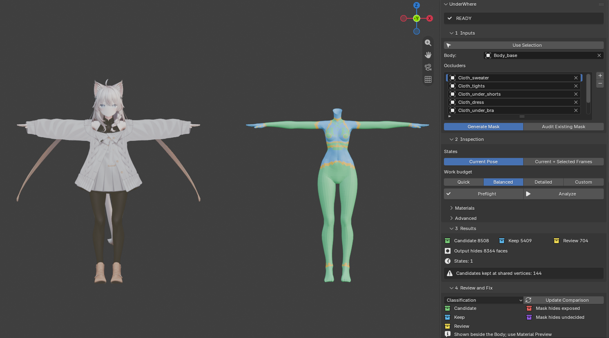

# UnderWhere

[](https://github.com/marc2825/BodyOcclusionCuller/releases)
[](LICENSE)

[日本語](README.md) | [English](README_EN.md)




> 動作確認は Windows 版 Blender 5.2.3 LTS で行っています。

衣装の下に隠れている身体メッシュの可視性を調べ、非表示用のマスクや、その面を削除したコピーを作る Blender Extension です。元の Body Mesh には手を加えず（非破壊的）、消しても確実に影響がない面や、必ず残す必要のある面を表示します。

※ 隠れた面を消すと、次のような利点があります：
- **軽量化**：ポリゴン数が減ります。
- **貫通対策**：動いたときに、身体が衣装を突き抜けて見えにくくなります。


## インストール

[GitHub Releases](https://github.com/marc2825/BodyOcclusionCuller/releases) から Extension の ZIP を入手し、Blender の **Preferences → Get Extensions → Install from Disk** で読み込みます。ZIP は展開しないでください。3D View で N キーを押し、UnderWhere タブを開きます。

## 使い方（概要）

画面は「準備」「確認」「書き出し」の 3 段階に分かれています。言葉は Blender の言語設定に合わせて日本語か英語で表示されます。

1. **準備**：衣装を選び、最後に素体（Body）を選んで「選択から設定」を押し、「調べる」を押します。
2. **確認**：調べ終わると、判定の色が表示されます。表示する場所は「素体の横」（比較メッシュ）か「素体の上」から選べます。緑は隠せる面、青は見える面、黄は判断できなかった面（要確認）です。「次にやること」に沿って、要確認の面を「残す」か「隠す」に決めます。
3. **書き出し**：「マスクで隠したコピーを作る」か「面を削除したコピーを作る」を押します。VRChat 向けに FBX で書き出す場合は後者を使います。

詳しくは[操作ガイド](docs/user/QUICKSTART_JA.md)を参照してください。English: [overview](docs/user/OVERVIEW_EN.md)

## 注意

判定は、検査したポーズでの有限個のサンプルに基づく候補であり、近似的な判定結果です。細い隙間、検査していないポーズやフレームの間、影・反射・物理演算については保証しません。出力したモデルは、実際に使うポーズで確認してください。

不具合を報告するときは **Export Shareable Report** で書き出したレポートを添付してください。メッシュの形状やオブジェクト名は含まれません。（完全な診断データ（Private full diagnostics）や購入したモデルは公開しないでください。）

## 関連文書

- [操作ガイド](docs/user/QUICKSTART_JA.md)
- [English overview](docs/user/OVERVIEW_EN.md)
- [動作確認](docs/testing/VERIFICATION.md)
- [変更履歴](CHANGELOG.md)
- [ロードマップ](ROADMAP.md)

Teaser画像の使用モデル：[しなの](https://booth.pm/ja/items/6106863)（ポンデロニウム研究所）

※ **UnderWhere** はアドオンの正式名称、**BodyOcclusionCuller** はソースコードを公開するリポジトリ名です。

## 開発

Python の標準ライブラリと、Blender に同梱されたモジュールだけを使っています。

```bash
python3 scripts/extension/run_tests.py --blender /path/to/blender        # テスト
python3 scripts/extension/package_extension.py --blender /path/to/blender # ZIP の作成
blender -b --factory-startup --python scripts/extension/create_sample.py  # デモの生成
```

## ライセンス

[Original License](LICENSE)（独自の利用規約）。Copyright (c) 2026 marc2825

アドオンは無料で、仕事を含めて自由に使えます。このアドオンで作ったアバターや衣装は、販売を含めて自由に使えます。一方、アドオン自体（改変したものを含む）の再配布と販売はできません。入手先として紹介するときは、このリポジトリか [Releases](https://github.com/marc2825/BodyOcclusionCuller/releases) へのリンクにしてください。（将来的にライセンスを変えるつもりはあります。）
