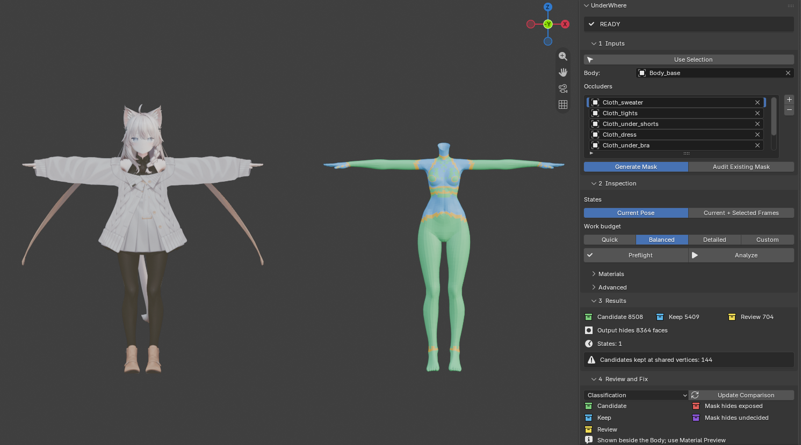

# UnderWhere

[](https://github.com/marc2825/BodyOcclusionCuller/releases)
[](LICENSE)

[日本語](README.md) | [English](README_EN.md)



Model: [Shinano](https://booth.pm/en/items/6106863) (ポンデロニウム研究所)

UnderWhere is a Blender Extension that analyzes which faces of a body mesh are hidden beneath clothing and creates either a mask to hide those faces or a copy with them removed. It leaves the original Body untouched and highlights faces that should remain visible or could not be reliably classified. It works entirely offline.

Removing the hidden faces has benefits such as:
- **Lighter avatars:** fewer polygons.
- **Less poke-through:** the body shows through the clothing less often when the avatar moves.

> Tested on Blender 5.2.3 LTS for Windows.

## Installation

Download the Extension ZIP from [GitHub Releases](https://github.com/marc2825/BodyOcclusionCuller/releases), then install it in Blender via **Preferences → Get Extensions → Install from Disk**. Do not extract the ZIP file.

In the 3D Viewport, press **N** to open the sidebar and select the UnderWhere tab.

## Quick Start

The sidebar has three steps: **Set up**, **Review** and **Export**. It follows Blender's language setting (English or Japanese).

1. **Set up:** select the clothing, then the Body last, press **Use selection**, then **Analyze**.
2. **Review:** the verdict colours appear, beside the Body or on the Body itself, as you choose. Green faces are hideable, blue faces are visible, and yellow faces are unsure. Follow **Next steps** and choose **Keep** or **Hide** for the unsure faces.
3. **Export:** press **Create masked copy**, or **Create copy with faces removed** for FBX export to VRChat.

For more details, see the [User Guide](docs/user/OVERVIEW_EN.md). Japanese: [操作ガイド](docs/user/QUICKSTART_JA.md).

## Limitations

The classification results are estimates based on a finite number of samples from the tested poses. The extension cannot guarantee correct results for narrow gaps, untested poses, intermediate frames, shadows, reflections, or physics simulations.

Always inspect the exported model in the poses in which it will actually be used.

When reporting a bug, please attach a report generated with **Export Shareable Report**. These reports do not contain mesh geometry or object names. Do not publicly share full diagnostic data (**Private full diagnostics**) or purchased models.

## Documentation

- [User Guide (Japanese)](docs/user/QUICKSTART_JA.md)
- [English Overview](docs/user/OVERVIEW_EN.md)
- [Verification](docs/testing/VERIFICATION.md)
- [Changelog](CHANGELOG.md)
- [Roadmap](ROADMAP.md)

**UnderWhere** is the official name of the add-on, while **BodyOcclusionCuller** is the name of the source code repository.

## Development

The extension uses only Python's standard library and modules bundled with Blender.

```bash
python3 scripts/extension/run_tests.py --blender /path/to/blender        # Run tests
python3 scripts/extension/package_extension.py --blender /path/to/blender # Build ZIP
blender -b --factory-startup --python scripts/extension/create_sample.py  # Generate demo
```

On every push to `main` and every pull request, GitHub Actions runs the tests and validates the ZIP with Blender for Linux. To release, update the version in `blender_manifest.toml` and `CHANGELOG.md`, then run `git tag v1.0.0` and `git push origin v1.0.0`. After the tests pass, a draft release is created with the ZIP, its SHA-256 and the demo attached; review it and publish it.

## License

[Original License](LICENSE) (custom terms). Copyright (c) 2026 marc2825

The add-on is free to use for any purpose, including commercial work, and avatars and outfits you make with it are yours to use and sell. You may not redistribute or sell the add-on itself, modified or not; to share it, link to this repository or its [Releases](https://github.com/marc2825/BodyOcclusionCuller/releases).